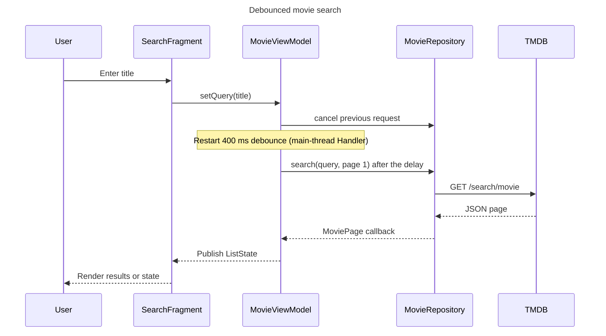
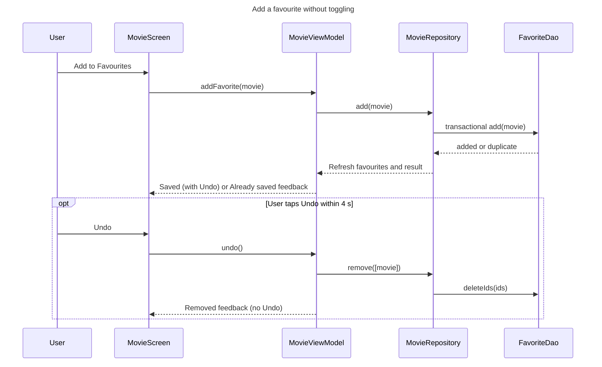

# Current Architecture and Main Sequences

These diagrams describe the implemented Java/XML application. They supersede
the earlier planning PNGs, which used separate screen ViewModels and separate
favourite/detail model names that were never implemented.

## MVVM and Data Flow

`MovieViewModel` is activity-scoped. `LiveData` drives loading, success, empty,
error, retry, feedback, busy-ID, and favourites states. `SavedStateHandle` keeps
the active tab, query, selection, sorting, and scroll positions across
recreation. Volley performs network and parsing work off the main thread; the
repository serializes Room work on one background executor.

## Search Sequence

The debounce timer lives in `MovieViewModel`: each new query cancels the previous request and pending timer. The query is saved to the recent-search history only when the user confirms it (Search key, picking a suggestion, or opening a result), so partial text typed while searching is never stored. Generation IDs ignore obsolete callbacks, and the current `ListState` is retained rather than re-requested during ordinary Activity recreation.

## Add Favourite Sequence

A duplicate add never deletes or replaces the stored row. A successful add
carries the added movie in feedback, so Undo can take it out again. Explicit
single or batch removal is available only from Favourites, and successful
removal carries the removed movies in feedback so Undo can restore them.
On the Details screen, the button already reads "Already in Favourites" for a saved movie and does not call `addFavorite`, so no duplicate feedback appears there.

## Remove Favourite Sequence

