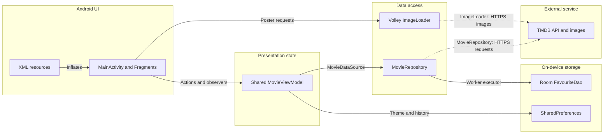
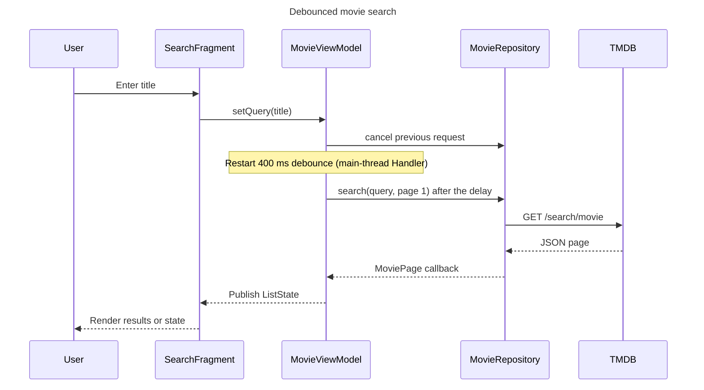
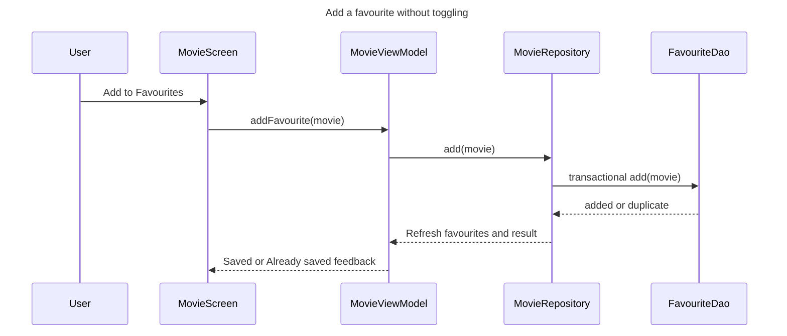
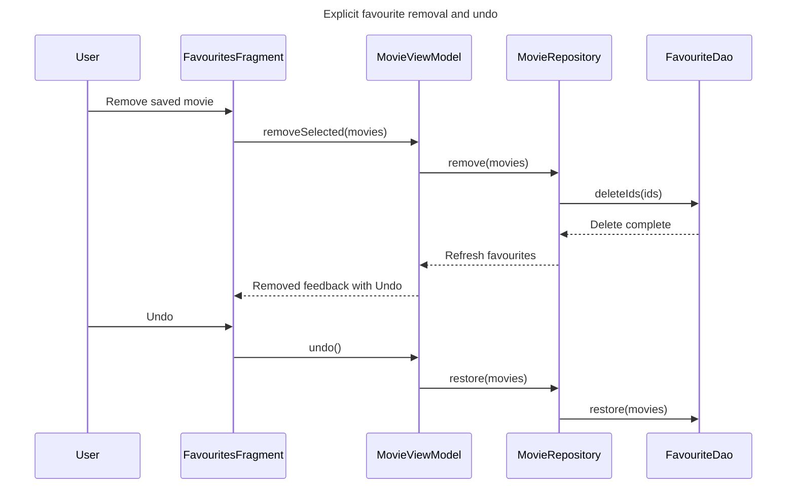

# Current Architecture and Main Sequences

These diagrams describe the implemented Java/XML application. They supersede
the earlier planning PNGs, which used separate screen ViewModels and separate
favourite/detail model names that were never implemented.

## MVVM and Data Flow

`MovieViewModel` is activity-scoped. `LiveData` drives loading, success, empty,
error, retry, feedback, busy-ID, and favourites states. `SavedStateHandle` keeps
the active tab, query, selection, sorting, and scroll positions across
recreation. Volley performs network and parsing work off the main thread; the
repository serializes Room work on one background executor.

## Search Sequence

The debounce timer lives in `MovieViewModel`: each new query cancels the previous
request and pending timer, and the query is saved to the recent-search history
only when the timer fires. Generation IDs ignore obsolete callbacks, and the
current `ListState` is retained rather than re-requested during ordinary
Activity recreation.

## Add Favourite Sequence

A duplicate add never deletes or replaces the stored row. Explicit single or
batch removal is available only from Favourites, and successful removal carries
the removed movies in feedback so Undo can restore them.

## Remove Favourite Sequence

